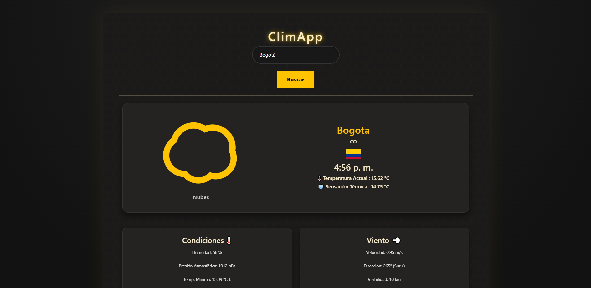

# react-weather-app 🌤️

A weather app built with React that lets you search any city and get current conditions at a glance — temperature, humidity, wind, and more, all with animated weather icons.

**[Live demo →](https://weather-app-brandon.vercel.app/)**

---

## Features

- Search weather by city name
- Animated icons that match current conditions (sunny, cloudy, rainy, etc.)
- Radar chart showing a visual breakdown of weather data
- Loading spinner while fetching data
- Responsive layout with Bootstrap

## Tech stack

- React 19 + Vite
- OpenWeatherMap API
- react-animated-weather
- react-svg-radar-chart
- react-spinners
- Bootstrap 5

## Getting started

1. Clone the repo and install dependencies:

```bash
git clone https://github.com/bnradon/react-weather-app.git
cd react-weather-app
npm install
```

2. Create a `.env` file in the root with your OpenWeatherMap API key:

```
VITE_WEATHER_API_KEY=your_api_key_here
```

You can get a free key at [openweathermap.org](https://openweathermap.org/api).

3. Start the dev server:

```bash
npm run dev
```

## Preview



## Deployment

This app is deployed on Vercel. To deploy your own fork:

```bash
npm run build
```

Then push to GitHub and import the repo on [vercel.com](https://vercel.com). Don't forget to add `VITE_WEATHER_API_KEY` as an environment variable (.env) in the Vercel dashboard.

---

Made by [bnradon](https://github.com/bnradon) :)